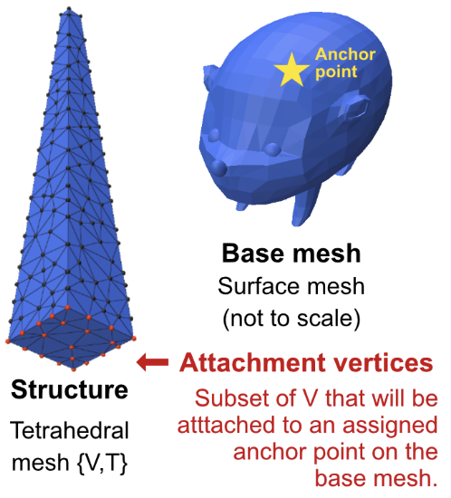

# Fast Modal Dynamics for Hairy and Scaly Surfaces on the GPU
**Yixin Lok, David I.W. Levin**
SIGGRAPH Posters 2026

[Paper (ACM DL)](https://dl.acm.org/doi/full/10.1145/3799825.3818761)

<p align="center">
  
</p>

Code for *Fast Modal Dynamics for Hairy and Scaly Surfaces on the GPU*.

## Installation

```bash
git clone https://github.com/yixinlok/furry-frequencies.git
cd furry-frequencies
 
uv venv
source .venv/bin/activate        # Windows: .venv\Scripts\activate
uv pip install -r requirements.txt
```

## Running the code
 
```bash
python src/main.py
```

## Using your own meshes

<p align="center">
  
</p>
The simulation requires the following input:

- **SURFACE_STRUCTURE**: (hairs, scales, etc.) as a `.msh` file.
- **BASE_MESH**: the structures sit on, as an `.obj` file.
- **ATTACHMENT_VERTICES**: indices of the tet-mesh vertices that are pinned to the base mesh. `base_instance.py` provides an interface to select and save an array of attachment vertices.
- **ANCHOR_FACES**: indices of the base-mesh triangles where anchor points are placed. `base_mesh.py` provides an interface to select and save an array of anchor faces.


These index lists can be very long, so they are set in `src/globals.py` rather than arguments on the command line. To use your own meshes, add these variables there. More details for other variables are also in `src/globals.py`.

## Acknowledgments
 
This project builds on the following open-source work:
 
- Linear elasticity Hessian code from [SimKit](https://github.com/otmanon/simkit)
- USD export from [usdmultimeshwriter](https://github.com/dilevin/usdmultimeshwriter)
- Tetrahedral meshes generated with [TetWild](https://github.com/Yixin-Hu/TetWild)

## Citation
 
If you find this code useful, please cite:
 
```bibtex
@inproceedings{lok2026fastmodal,
  title     = {Fast Modal Dynamics for Hairy and Scaly Surfaces on the GPU},
  author    = {Lok, Yixin and Levin, David I.W.},
  booktitle = {ACM SIGGRAPH 2026 Posters},
  year      = {2026},
  doi       = {10.1145/3799825.3818761}
}
```